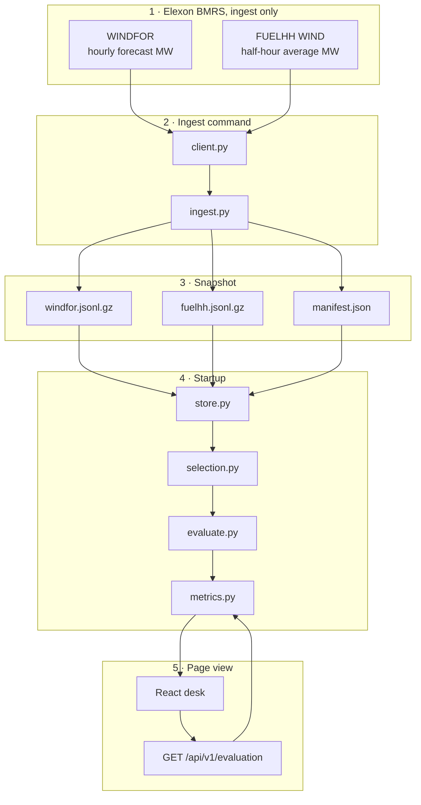

# Northline

Historical day-ahead wind desk for a GB electricity supplier. For each purchase decision made on a London day in January 2026, it shows the national wind forecast that had already been published, the later half-hourly outturn, and the error. This is a replay of January 2026. It does not estimate demand, price, or a hedge volume.

**Live application:** [https://northline-ruby.vercel.app/](https://northline-ruby.vercel.app/)

**Video:** [https://www.loom.com/share/9a1e2fbb126f40d29d22a99098b9784c](https://www.loom.com/share/9a1e2fbb126f40d29d22a99098b9784c)

14 January decision, cutoff 09:20: [https://northline-ruby.vercel.app/?date=2026-01-14&cutoff=09:20](https://northline-ruby.vercel.app/?date=2026-01-14&cutoff=09:20)

Hosted on Vercel. The page reads a committed Elexon snapshot. It does not call Elexon on each request.

## Result for the default rule

Decision dates are 1–31 January 2026. Each decision buys the next delivery day. The default cutoff is 09:20 Europe/London, the EPEX SPOT GB 60-minute day-ahead gate. In January that is 09:20 UTC, so the latest eligible WINDFOR file is the 07:30 UTC run. The 09:30 run is excluded.

From snapshot `8e87d9346bc99a87`, retrieved from Elexon at 2026-10-24T18:16:34Z:

| | |
| --- | --- |
| Hours scored | 744 of 744 |
| MAE | 2,038.91 MW |
| RMSE | 2,504.76 MW |
| Bias (forecast − actual) | +1,747.89 MW |
| WAPE | 18.07% |
| Error p10 / p50 / p90 | −549.30 / +1,592.00 / +4,097.90 MW |

Positive bias means the forecast overstated wind. On 14 January, for delivery on 15 January, the 07:30 forecast’s hourly MAE and bias are both 1,041.83 MW and RMSE is 1,149.26 MW. Hour 00:00 is forecast 15,834 MW against half hours 14,602 and 14,311. `backend/tests/test_snapshot.py` locks these figures.

## Files and directories

```text
.
├── app.py                     Vercel imports this; it re-exports the FastAPI app
├── pyproject.toml             package metadata and the Vercel entrypoint
├── requirements.txt           runtime pins, including tzdata for Europe/London
├── requirements-dev.txt       pytest
├── vercel.json                frontend build, snapshot path, static desk path
├── Dockerfile                 production image: API and built desk on one port
├── Dockerfile.dev             API image used by Compose, with reload
├── docker-compose.yml         API on 8000, Vite on 5173
├── .env.example               SNAPSHOT_PATH, STATIC_DIR, Elexon URL, optional key, PORT
├── .python-version            3.12
├── README.md
├── backend/
│   ├── app/
│   │   ├── main.py            create the app, load the snapshot, serve the desk
│   │   ├── config.py          January window, cutoffs, paths
│   │   ├── log_config.py      JSON request logs, no response bodies
│   │   ├── api/routes.py      /api/v1/health, /meta, /evaluation
│   │   ├── domain/
│   │   │   ├── time.py        London and UTC, including the DST edge days
│   │   │   ├── selection.py   publishTime <= cutoff; one file or latest hour
│   │   │   ├── alignment.py   pair the two FUELHH half hours
│   │   │   ├── metrics.py     MAE, RMSE, bias, WAPE, quantiles
│   │   │   ├── evaluate.py    join a decision day and score it
│   │   │   └── models.py      wire records and API models
│   │   ├── elexon/
│   │   │   ├── client.py      public stream client, retries, optional API key
│   │   │   └── ingest.py      day-sized download, coverage checks, snapshot write
│   │   └── snapshot/store.py  gzipped JSONL, checksums, six precomputed evaluations
│   └── tests/
│       ├── test_time.py
│       ├── test_evaluate.py   recorded 15 January hour and the selection rules
│       ├── test_client.py     retry, HTTP 400, malformed JSON
│       ├── test_api.py
│       ├── test_snapshot.py   locks the 744-hour January totals
│       └── fixtures/recorded_2026_01_15.json
├── data/snapshot/
│   ├── windfor.jsonl.gz       19,272 forecast rows
│   ├── fuelhh.jsonl.gz        1,488 half-hour WIND rows
│   └── manifest.json          snapshot 8e87d9346bc99a87 and the BMRS licence
├── frontend/
│   ├── index.html
│   ├── package.json
│   ├── vite.config.ts         proxies /api to the Python process in development
│   ├── public/favicon.svg
│   └── src/
│       ├── main.tsx
│       ├── App.tsx            loads meta and evaluation and holds the page together
│       ├── components/        decision bar, verdict, generation chart, month strip,
│       │                      error distribution, interval table, assumption panel
│       ├── hooks/             URL state, reduced motion, count-up
│       ├── lib/               API client, types, formatting, scales
│       ├── styles/            tokens.css and desk.css
│       └── test/desk.test.tsx
└── docs/
    ├── VIDEO_SCRIPT.md
    └── decision-2026-01-14.png
```

`.venv/`, `frontend/node_modules/`, and `frontend/dist/` are created locally and are not committed.

## How to start the application

Open [https://northline-ruby.vercel.app/](https://northline-ruby.vercel.app/).

To run it locally, use Python 3.12 from the repository root:

```text
python -m venv .venv
.venv\Scripts\activate
pip install -r requirements-dev.txt
.venv\Scripts\python -m uvicorn backend.app.main:app --host 127.0.0.1 --port 8000
```

In another shell:

```text
cd frontend
npm install
npm run dev
```

Open `http://127.0.0.1:5173/?date=2026-01-14&cutoff=09:20`. The Vite server proxies `/api` to port 8000.

Docker, with the API on port 8000 and Vite on port 5173:

```text
docker compose up --build
```

Production image, API and built desk together:

```text
docker build -t northline .
docker run --rm -p 8000:8000 northline
```

Open `http://127.0.0.1:8000/?date=2026-01-14&cutoff=09:20`.

Refresh the snapshot from Elexon, replacing it only after the coverage checks pass:

```text
python -m backend.app.elexon.ingest
```

| Variable | Purpose |
| --- | --- |
| `SNAPSHOT_PATH` | Snapshot directory. Default `data/snapshot`. |
| `STATIC_DIR` | Built desk. Empty when the API is run without the built frontend. |
| `ELEXON_BASE_URL` | Insights API base. Used only by the ingest command. |
| `ELEXON_API_KEY` | Optional. Sent as `X-Api-Key` only when set. The public API did not require one. |
| `PORT` | Listen port in the production container. |

Copy `.env.example` for a local file.

## Stack

- Python 3.12, FastAPI, Pydantic v2, httpx
- React 19, TypeScript, Vite, TanStack Query
- Docker Compose for local development, and a production image that serves the built desk and the API together

## Data

Contains BMRS data © Elexon Limited copyright and database right 2026.
[BMRS data licence](https://www.elexon.co.uk/bsc/data/balancing-mechanism-reporting-agent/copyright-licence-bmrs-data/).

The Insights API is public. These calls used no API key. Base URL: `https://data.elexon.co.uk/bmrs/api/v1`.

- Actuals: `GET /datasets/FUELHH/stream` with `fuelType=WIND`. `generation` is average MW over the half hour. The delivery window 2 January–1 February 2026 returned 1,488 rows, 48 settlement periods a day.
- Forecasts: `GET /datasets/WINDFOR/stream`, filtered by `publishTime`. Each value is one hourly MW figure. There is no settlement period on the stream record.

WINDFOR is hourly. FUELHH is half-hourly. The scored actual for an hour is the mean of the two half hours starting at that hour and 30 minutes later. The forecast is drawn flat across that hour. It is not copied onto 48 separate samples.

In this January extract the files are at 02:30, 04:30, 07:30, 09:30, 11:30, 15:30, 18:30 and 22:30 UTC. On 15 January the 11:30 file is replaced by one at 12:25 UTC. Selection uses `publishTime`.

## Decision rule

A decision on London date D procures delivery D+1. A forecast is eligible when `publishTime <= cutoff`.

- `09:20` is the default: EPEX SPOT GB 60-minute auction. The vintage is 07:30.
- `09:50` is the Nord Pool N2EX gate. The 09:30 file becomes eligible.
- `15:30` is the EPEX GB 30-minute auction. A file stamped exactly 15:30 is included.

The default strategy keeps one publication, the latest file at or before the cutoff, and does not fill a missing hour from an older or newer file. “Latest hour” lets each delivery hour use a different eligible publication.

`error = forecast − actual`. Positive means overforecast. MAE, RMSE, and bias are computed on scored hours only. WAPE is undefined if the actual sum is zero. Missing, conflicting, or implausible rows (below 0 MW or above 50,000 MW) stay out of the metrics. A zero is a real value. These metrics are not a volume to buy.

```text
GET /api/v1/health
GET /api/v1/meta
GET /api/v1/evaluation?cutoff=09:20&strategy=single_vintage
```

`cutoff` is `09:20`, `09:50`, or `15:30`. `strategy` is `single_vintage` or `latest_interval`. If the snapshot is missing, health returns 503.



## Tests

```text
python -m pytest
cd frontend && npm test
```

## AI tools

Cursor’s coding agent, Grok 4.7, was used to research the Elexon and auction sources, retrieve and check the January extracts, and implement the application, tests, and this README. The forecast rule, the hourly alignment, and the metrics were locked against the retrieved Elexon rows.
